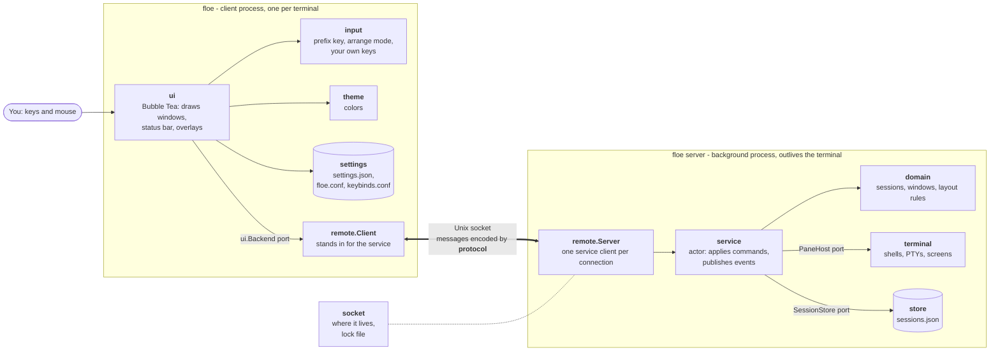
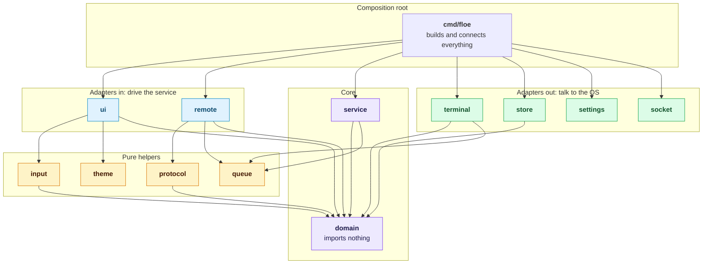
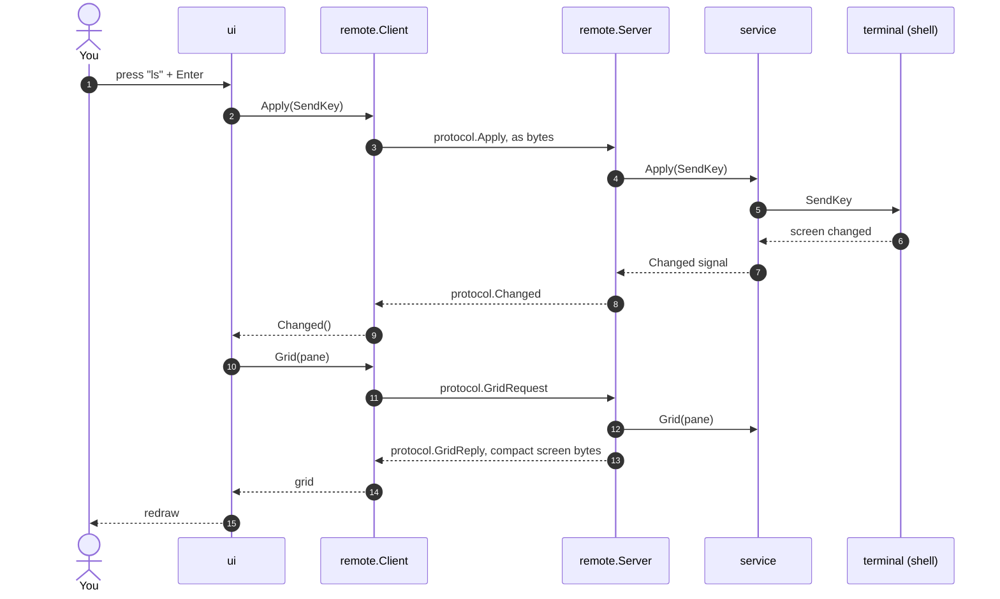

# Architecture

floe is two processes. The **server** runs in the background and owns every
session, window and program. The **client** is what you run in a terminal: it
draws what the server sends and passes on your keys and mouse. Closing the
terminal only ends the client, so programs keep running.

## The two processes

## The layers

Arrows point the way imports go: inward, towards the domain. Nothing inside
knows about what is outside it. `internal/archtest` fails the tests if an
import breaks this.

| Layer | Packages | Job |
|---|---|---|
| Domain | `domain` | What sessions and windows are, and the rules for them |
| Service | `service` | Runs the domain: one actor goroutine, per-responsibility services, ports |
| Adapters in | `ui`, `remote` | Drive the service: the terminal UI, and the socket bridge |
| Adapters out | `terminal`, `store`, `settings`, `socket` | Implement ports with the OS: PTYs, files, sockets |
| Helpers | `protocol`, `input`, `theme`, `queue` | Pure building blocks |
| Root | `cmd/floe` | `floe` runs the client, `floe server` the server |

## A key press, end to end

## Why the split was cheap

The UI only knows the `ui.Backend` port, and the service only knows its own
clients. Putting `remote.Client` behind the port and `remote.Server` in front
of the service moved the service into another process without changing
either of them.

## Where new things go

| To add | Start in |
|---|---|
| A panel that takes the keyboard, such as a picker, a prompt or copy mode | `ui/overlay.go`: implement `overlay` and open it from `runAction` |
| Something the mouse does | `ui/mouse.go`, which routes presses to `hittest.go`, `drag.go`, `selection.go` and `scroll.go` |
| A key binding | `input/keymap.go`; its name then works in `keybinds.conf` |
| A command or event between client and server | `domain/command.go` or `event.go`, then `protocol/register.go` |
| A window rule, such as how windows snap | `domain/session_arrange.go`, or `session_focus.go` for focus and marks |
| A field saved with a window | `domain.SavedWindow` and the file format in `infra/store`. The round-trip tests in both fail until they give the new field a value |
